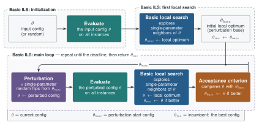

# 🐏 RamParILS

A parallel Rust rewrite of [ParamILS](https://www.cs.ubc.ca/labs/algorithms/Projects/ParamILS/) —
automated algorithm configuration via Iterated Local Search.

Used as the inner tuner in [Grackle](https://github.com/ai4reason/grackle), a strategy portfolio
invention system for automated reasoning solvers.

**Current release: v0.3.0** (2026-10-29) · [changelog](changelog.md) ·
[sources and issues on GitHub](https://github.com/deeper4ai/ramparils) ·
[installation](installation.md)

```bash
pip install ramparils                                          # Python extension
cargo install --git https://github.com/deeper4ai/ramparils --tag v0.3.0 --locked   # CLI
```

## 📦 What's new in 0.3.0

- **Exact adaptive capping.** The cap now tests the cumulative sum against the
  budget beating the incumbent allows, so it never discards a configuration
  that would have been accepted, and one slow instance can no longer cap a
  configuration outright. Capped scores are logged as lower bounds,
  `>2.698475 (312/473)`. `bound_multiplier` keeps its meaning.
  See [Algorithm](reference/algorithm.md).
- **Wrapper startup check and `runhash`.** `ramparils` runs `<algo> --version`
  before the first evaluation and refuses to start unless the wrapper can reach
  its solver; the answer is logged, so a run records which solver build it
  used. Wrappers may also report a `runhash`, a fingerprint of the solver's
  own work, exported by the new `ramparils db runhashes` to find parameters
  that change nothing. **Wrappers without `--version` must add it.**
  See [Solver protocol](reference/protocol.md).
- **`futell`, an opt-in early rejection** of losing neighbours from a
  checkpoint partway through their evaluation. Heuristic and off by default.
- **`instance_shuffle`**, on by default: the instance list is shuffled once,
  deterministically, before dispatch, so evaluation order changes for
  existing scenarios. Set `instance_shuffle: false` to keep the file's order.
- **`cache_disable`** forces every evaluation to run, for checking whether
  cache hits skew a result.
- **Fixes:** an incomplete (capped) evaluation can no longer win an
  acceptance comparison and corrupt the incumbent; debug and error logs append
  instead of truncating on a rerun; the error log only appears when something
  crashed; the example wrappers report crashes as `UNKNOWN` with the full
  cutoff, never as a cheap cacheable result.
- **Agent skills** under `skills/` for running a whole tuning campaign:
  domain, wrapper, scenario, analysis and evaluation with solverpy.

## 📦 What was new in 0.2.0

- **One command-line tool, two sub-commands.** `ramparils run scenario.yaml`
  tunes; `ramparils db cache.dbcache` exports what a result cache holds. This
  replaces `--scenariofile` and the separate `ramparils-db` binary, so **0.2.0
  is not CLI-compatible with 0.1.x** — scenario files, parameter files, caches
  and the Python API are unchanged, only the invocation moves.
  See [CLI](usage/cli.md).
- **A search that can climb out of a local optimum.** The acceptance criterion
  alone could only ever move downhill, so a strong local optimum ended the
  useful part of a run. Soft acceptance within a tolerance, stagnation-triggered
  restarts, a choice of restart target, and ParamILS's random probes now
  address it — all off by default.
  See [Algorithm](reference/algorithm.md#escaping).
- **Provenance.** `ramparils --version` and the header of every debug log carry
  the git revision the binary was built from, with a `-dirty` marker when the
  worktree was not clean. A version number alone never said which code ran.
- **`ramparils db confs`** recovers the configuration behind each strategy hash
  in a cache, so a `.dbcache` is no longer a pile of opaque hashes.

Full detail, including the earlier releases, is in the [changelog](changelog.md).

## 💡 What it does

Given a target algorithm with configurable parameters, RamParILS searches for the parameter
setting that minimises runtime or a numeric solution cost on a set of training instances.
It uses **FocusedILS** by default. RamParILS starts by scoring configurations on a configurable
prefix of the training instances and increases that shared fidelity when the incumbent survives a
challenge. Neighbours are submitted to a bounded worker pool, and the first fully evaluated
improvement is accepted. Results can be stored in a **persistent SQLite cache** for reuse by
compatible tuning runs.

Cache entries are keyed only by the active configuration and instance path. Use a separate
cache when the algorithm command, cutoff, objective, solver version, wrapper behavior, or random
seed changes. Reusing a cache across incompatible scenarios can silently return stale results.

## 🚀 Key differences from Ruby ParamILS

| | Ruby ParamILS | RamParILS |
|---|---|---|
| Evaluation | Sequential | **Parallel** over all `(neighbour, instance)` pairs |
| Cache | In-memory, per-run | **Persistent SQLite**, shared across runs, self-describing |
| Cache inspection | — | `ramparils db solved \| status \| confs` |
| Python API | subprocess call | **Native extension** via PyO3 |
| Search modes | BasicILS, FocusedILS | BasicILS, FocusedILS, `random` (ParamILS's `pert_rand`) |
| Escaping a local optimum | Random restart at fixed probability (`p_restart`), `R` random probes | Both, **plus soft acceptance within a tolerance and stagnation-triggered restarts** |
| Restart target | Uniformly random configuration | Random, **or a bounded perturbation of the incumbent** |
| Comparing across fidelities | Score vector per configuration, compared at a common level | **Single score, re-measured** for the incumbent and the home base at every fidelity increase |
| Multi-phase schedules | — | **Iterative deepening**: geometric growth of instances, cutoff and deadline |
| Provenance | — | Source revision in `--version` and every log header; full scenario echoed at startup |
| Non-deterministic algorithms (multiple seeds) | Supported | Not (yet) supported |

Parallel evaluation is the primary motivation for the rewrite. Actual speedup depends on worker
count, neighbourhood width, current fidelity, solver runtimes, early acceptance, and cache hits.
The persistent cache compounds this advantage across compatible Grackle tuning runs on overlapping
problem sets.

<p align="center">
  
</p>

The search in its `basic` form: θ is the current candidate, θ_base the point each perturbation
starts from, and θ_inc the incumbent that the run returns. See [Algorithm](reference/algorithm.md)
for what each box does and for the FocusedILS fidelity schedule.

## 🔗 Quick links

- [Installation](installation.md)
- [CLI usage](usage/cli.md)
- [Python API](usage/python.md)
- [Algorithm](reference/algorithm.md)
- [Parameter file format](reference/params.md)
- [Solver wrapper protocol](reference/protocol.md)
- [Changelog](changelog.md)
- [GitHub repository](https://github.com/deeper4ai/ramparils)

## 🤝 Acknowledgements

This project is part of [DEEPER](https://deeper4ai.github.io/) and supported by the [DEEPER grant](https://www.renaissancephilanthropy.org/deeper-exploratory-engine-for-precise-expert-reasoning) from Renaissance Philanthropy.
